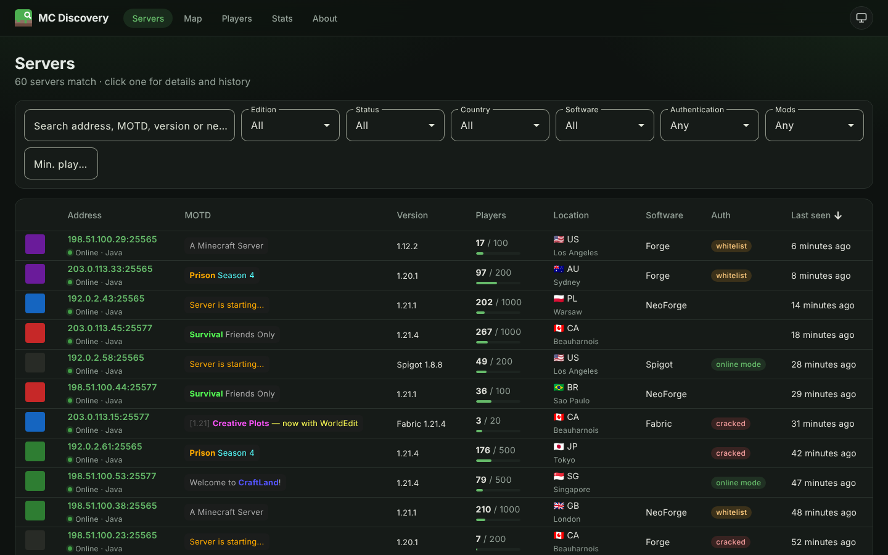
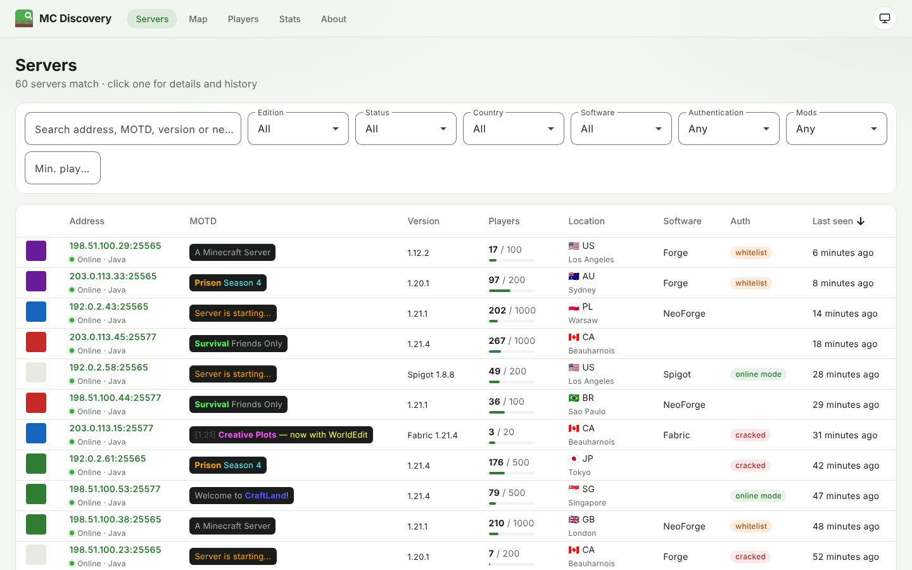
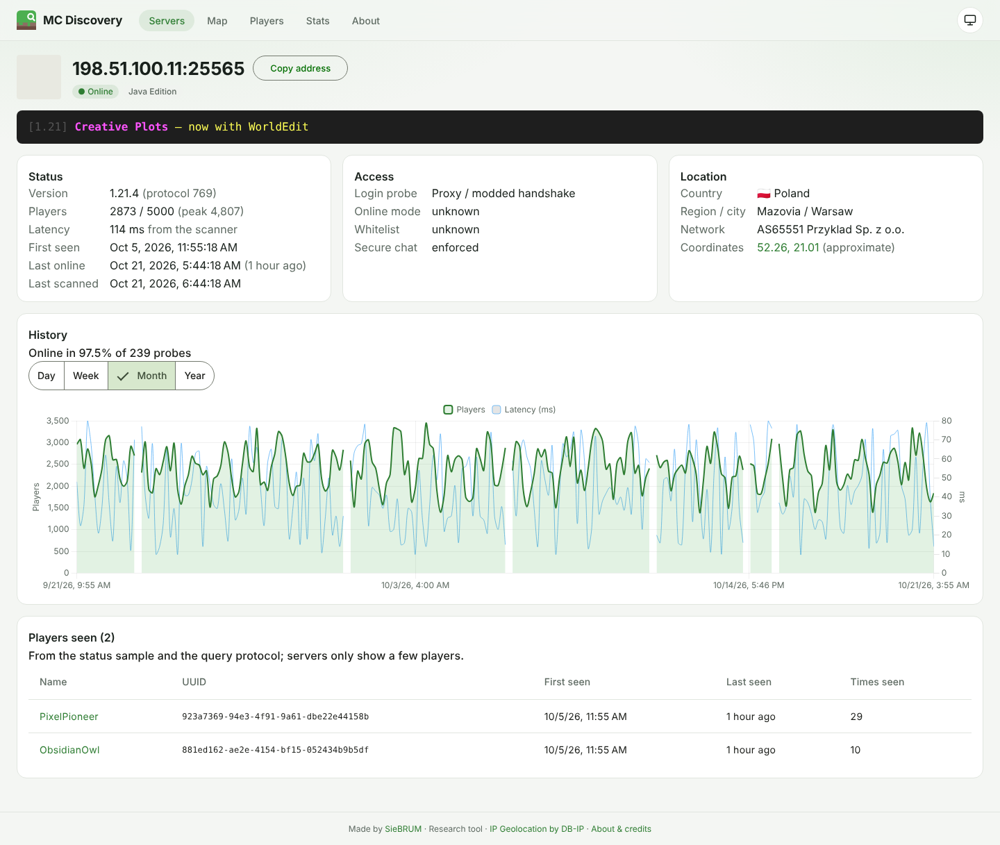
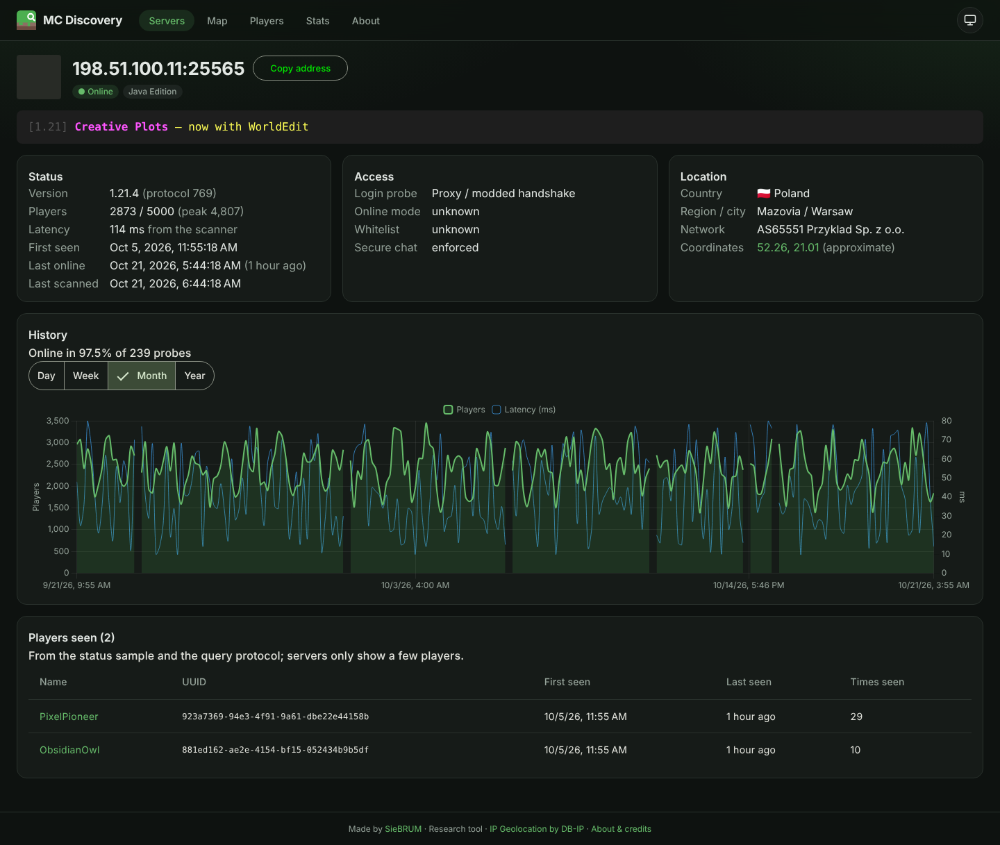
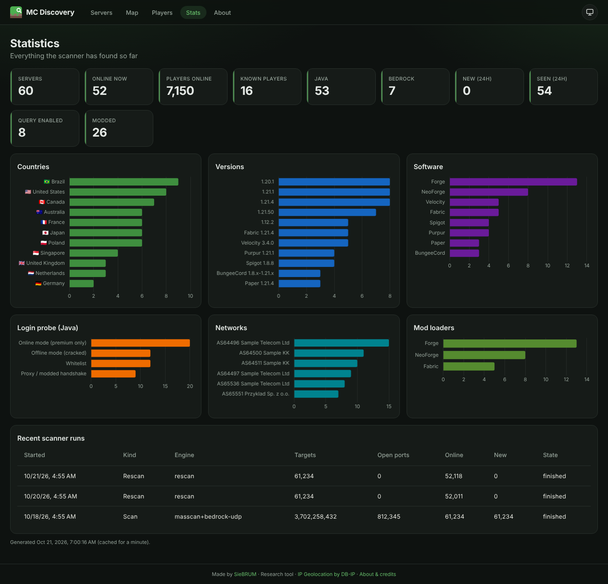
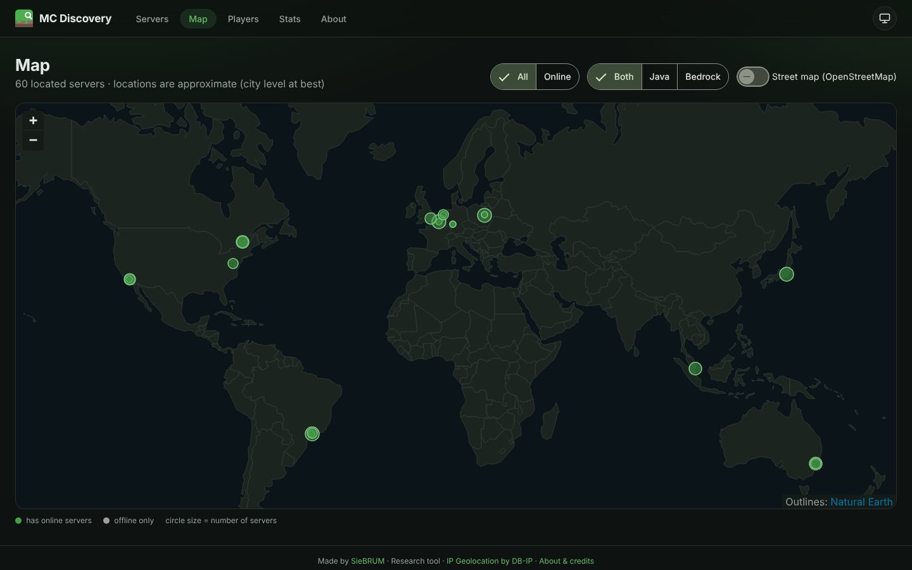
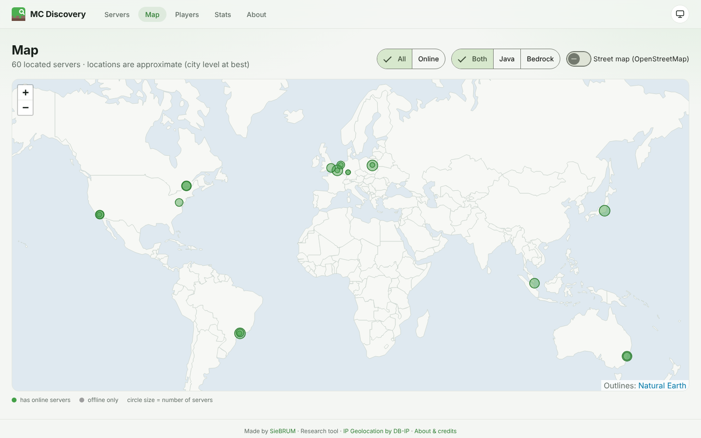
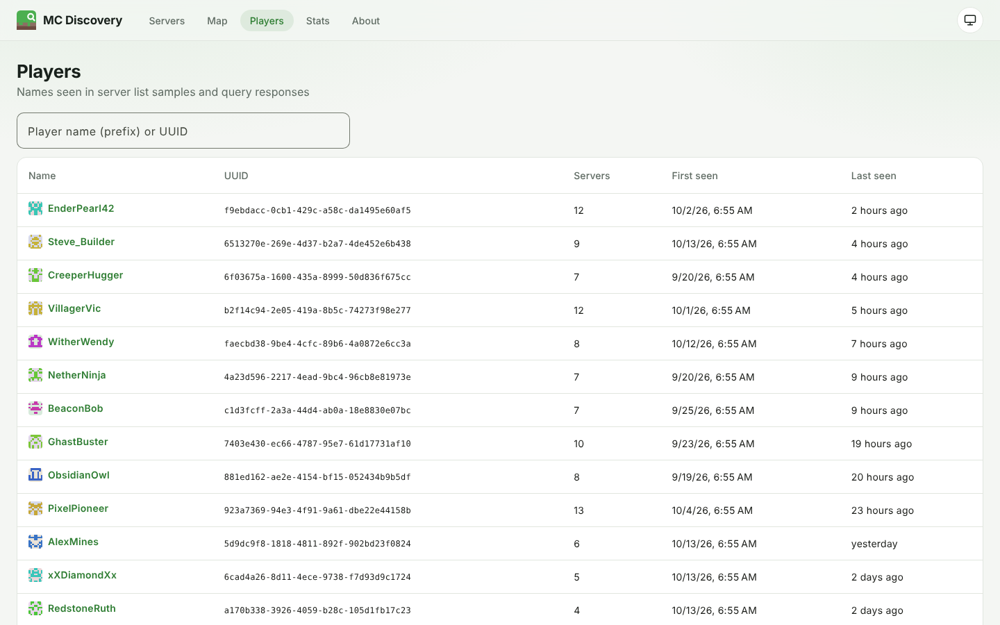
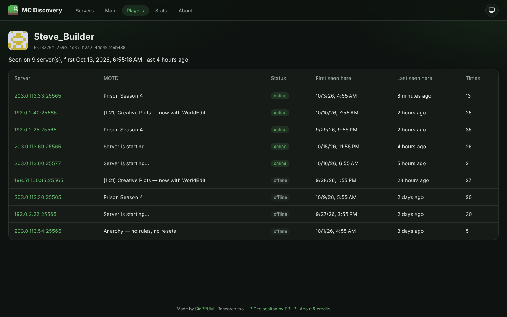

# Minecraft Server Discovery

[](https://github.com/SieBRUM/minecraft-server-discovery/actions/workflows/ci.yml)
[](https://github.com/SieBRUM/minecraft-server-discovery/actions/workflows/codeql.yml)
[](LICENSE)
[](https://github.com/SieBRUM/minecraft-server-discovery/stargazers)
[](https://github.com/SieBRUM/minecraft-server-discovery/network/members)
[](https://github.com/SieBRUM/minecraft-server-discovery/issues)
[](https://github.com/SieBRUM/minecraft-server-discovery/commits)
[](https://dotnet.microsoft.com)
[](https://angular.dev)
[](docker-compose.yml)

> *"There are an estimated several hundred thousand Minecraft servers on the internet. We wanted to know
> where they are, what they run, and why so many of them are called `A Minecraft Server`."*

Minecraft Server Discovery is a **research tool** for finding delicious Minecraft servers (diamonds, mostly)
in a gigantic, horribly boring haystack (the IPv4 internet, all 3.7 billion addresses of it). It writes down
everything those servers happily tell anyone who asks, and puts it on a website: a searchable server list,
server details with player/uptime history, a world map, player search and statistics.

It's a research tool. It's not a griefing tool, it's not a "find servers to wreck" tool, and it's not
production software with a support contract. It's a lab coat with a port scanner in the pocket.

<p align="center">
  
  
</p>

<sub>Screenshots use made-up demo data on documentation IP ranges. More in the [gallery](#gallery).</sub>

## Table of contents

- [What does it do?](#what-does-it-do)
- [Gallery](#gallery)
- [I'm a busy person and I don't have time to read all this](#im-a-busy-person-and-i-dont-have-time-to-read-all-this)
- [Please don't get us (or you) in trouble](#please-dont-get-us-or-you-in-trouble)
- [What does it collect?](#what-does-it-collect)
- [How does it work?](#how-does-it-work)
- [Running it with Docker (the easy way)](#running-it-with-docker-the-easy-way)
- [Building and running it without Docker (the scenic route)](#building-and-running-it-without-docker-the-scenic-route)
- [Driving the scanner](#driving-the-scanner)
- [Configuration](#configuration)
- [Putting it on the internet](#putting-it-on-the-internet)
- [Your data, backups and the big red button](#your-data-backups-and-the-big-red-button)
- [Hacking on it](#hacking-on-it)
- [It doesn't work!](#it-doesnt-work)
- [FAQ nobody asked for](#faq-nobody-asked-for)
- [Credits](#credits)
- [Stargazers](#stargazers)
- [License](#license)

## What does it do?

Three things, each in its own box, so you can kick one without upsetting the others:

- **The scanner** (C#/.NET 10) yells at a lot of IP addresses very quickly. It uses
  [masscan](https://github.com/robertdavidgraham/masscan) for stateless SYN scanning (the fast part), falls
  back to a built-in connect scanner if masscan isn't around (the less fast part), sweeps for Bedrock servers
  over UDP, and then talks to everything it finds with its own Minecraft protocol client (the nosy part).
- **The API** (C#/ASP.NET Core) is read-only, deeply suspicious of strangers, and only listens to
  localhost unless you tell it otherwise.
- **The website** (Angular 22) is the pretty part, now with a dark mode for 3 AM research sessions (it
  follows your OS, or click the toggle in the top right). It only ever talks to the API.

Everything lives in **one SQLite file** on a persistent Docker volume. **One `docker compose up`** starts the
whole circus, and the scanner can be restarted, rescanned or re-ingested on its own while the website keeps
running. Works on Linux (Ubuntu Server and friends) and Windows, with or without Docker. CI builds and tests
on both.

## Gallery

All screenshots use fictional demo data (documentation-only IP ranges, made-up names).

| | |
| --- | --- |
| **Server details**: MOTD, access, location, 30-day player and latency history |  |
| **Dark mode** |  |
| **Statistics**: countries, versions, software, login-probe results, networks, scan runs |  |
| **World map**: built-in offline map, OpenStreetMap street tiles optional |  |
| **Map, light** |  |
| **Players** |  |
| **Player details**: every server a player was seen on |  |

## I'm a busy person and I don't have time to read all this

Fair. Install Docker, then:

```bash
git clone https://github.com/SieBRUM/minecraft-server-discovery.git && cd minecraft-server-discovery
cp .env.example .env            # optional, every setting has a sane default
nano config/targets.txt         # add ranges you're ALLOWED to scan, e.g. 192.0.2.0/24
docker compose up -d --build
```

Open <http://localhost:8080>, make a coffee, and watch `docker compose logs -f scanner` go brrr.

That's it. Everything below is for people who like knowing things.

## Please don't get us (or you) in trouble

> [!IMPORTANT]
> Scanning networks you don't own may be against your provider's terms of service or the law where you
> live. Only scan what you're allowed to, start with low rates, honour opt-out requests (add them to
> `config/exclude.txt`) and consider turning off the login probe (see below). You are responsible for what
> you point this at. The authors are responsible for the bugs, not for your ISP's angry email.

Things the tool does to be a good citizen on its own:

- It **never** scans `0.0.0.0/8`, `127.0.0.0/8`, `169.254.0.0/16`, multicast or `240.0.0.0/4`, whatever you
  put in the targets file.
- `config/exclude.txt` skips private, CGNAT, documentation and benchmarking ranges out of the box.
- Targets are visited in a shuffled order, so no single network gets hammered.
- The scanner does nothing until you put targets in `config/targets.txt`. No surprise internet scans.
- CI never scans anything. The tests only bully fake servers on `127.0.0.1`.

## What does it collect?

Only what servers tell every client that asks, plus an offline GeoIP lookup. No passwords, no exploits, no
joining your server and placing dirt on your spawn.

| Source | What we get |
| --- | --- |
| Server list ping (Java 1.7+) | version and protocol, MOTD with all its colours, players online/max, player sample (names + UUIDs), server icon, `enforcesSecureChat`, `previewsChat`, `preventsChatReports`, Forge/NeoForge mod lists (including the weird packed 1.18+ format), latency |
| Legacy ping (pre-1.7) | version, MOTD and players from servers older than some of their players |
| Query protocol (UDP, `enable-query=true`) | server software, plugin list, map name, game type, the **full** player list |
| Login probe (optional) | online mode (premium only) vs. offline mode ("cracked"), whitelist, kick messages |
| Bedrock (RakNet unconnected ping) | MOTD, version, protocol, players, level name, game mode, server GUID, Education Edition |
| GeoIP (offline, DB-IP Lite) | continent, country, region, city, approximate coordinates, ASN and network name |
| Our own bookkeeping | first seen, last seen online, last scanned, online/offline, failed probes in a row, peak players, history (players, latency, up/down), which players were seen where and when, scan runs |

On top of that it guesses the server software (Paper, Purpur, Spigot, Velocity, BungeeCord, Forge, Fabric,
Geyser, …) and mod loader from the version string and query data. The guesses are usually right. Vanilla
servers just say `1.21.4` and keep their secrets.

**About the login probe:** to find out whether a server checks accounts with Mojang, the scanner starts a
login as `McDiscoveryBot` and hangs up the moment the server answers. It never actually joins, but it does
show up in the server's log, and on offline-mode servers older than 1.20.2 it can briefly look like a join.
If that makes you uneasy (reasonable!), set `SCAN_LOGIN_PROBE=false` in `.env` or pass `--login-probe=false`.
`--login-name` changes the name.

## How does it work?

```
                  ┌─────────────── scanner (mcd-scanner) ────────────────┐
config/targets ─▶ │ masscan SYN scan ─┐                                   │
                  │ connect fallback ─┼─▶ probe workers ─▶ batch writer ──┼─▶ SQLite (WAL)  ◀── API (read-only) ◀── website
                  │ Bedrock UDP sweep ┘   (status, legacy,   (+ GeoIP)    │   /data volume       :8080 (localhost)
                  └───────────────────    query, login)  ─────────────────┘
```

1. **Find open ports.** masscan sprays SYNs statelessly at your chosen rate and streams open ports back. No
   masscan? The built-in connect scanner opens thousands of connections in parallel instead (fine for a /16,
   a bit optimistic for the whole internet). Bedrock servers are found by a stateless UDP sweep: one socket
   fires RakNet pings at everything while a receiver catches the pongs, so it needs no special privileges.
   Targets are walked in a keyed pseudo-random order (a Feistel permutation, same idea as masscan's).
2. **Be nosy.** A pool of workers (`--concurrency`, default 512) talks to each open port: status ping first,
   legacy ping if that fails, then query and the login probe in parallel.
3. **Write it down.** Results go into the database in batches of 250, one short transaction each, so the
   website stays snappy while the scanner works. Players are deduplicated by UUID, and the fake "players"
   servers use as hover text (`§aWelcome to the server!`) are thrown out. Each unique server icon is stored once.

*"Why no message queue?"* Because SQLite in WAL mode already does exactly one writer plus many readers across
processes, and this project has exactly one writer plus many readers. A message broker would be one more
thing to babysit for zero benefit at this scale.

## Running it with Docker (the easy way)

**You need:** Docker with Compose v2 (Docker Engine on Linux, Docker Desktop on Windows/macOS) and git.

**Build and start everything:**

```bash
git clone https://github.com/SieBRUM/minecraft-server-discovery.git && cd minecraft-server-discovery
cp .env.example .env            # Windows PowerShell: copy .env.example .env
# edit config/targets.txt and add what you want to scan (empty file = the scanner politely does nothing)
docker compose up -d --build
```

This builds two images (`mcdiscovery-api`, which includes the website, and `mcdiscovery-scanner`, which
includes masscan) and starts them. The website is at <http://localhost:8080>. On the first scan the scanner
downloads the free DB-IP Lite GeoIP databases (roughly a hundred MB) into the data volume and refreshes
them monthly.

**Everyday commands:**

| I want to… | Command |
| --- | --- |
| Start / update everything | `docker compose up -d --build` |
| Watch the scanner work | `docker compose logs -f scanner` |
| Restart the scan (e.g. after editing `config/targets.txt`) | `docker compose restart scanner` |
| Stop just the scanner | `docker compose stop scanner` |
| Re-probe every known server once, website stays up | `docker compose run --rm scanner rescan` |
| Keep known servers fresh every hour | `docker compose --profile rescan up -d` |
| Do a one-off scan of a range | `docker compose run --rm scanner scan -t 192.0.2.0/24 --loop=false` |
| Back up the database | `docker compose run --rm scanner backup` ([details](#your-data-backups-and-the-big-red-button)) |
| Stop everything (data is kept) | `docker compose down` |

The scanner runs with host networking and only the `NET_RAW` and `NET_ADMIN` capabilities. That's what
masscan needs; it opens no ports. [Why host networking?](#faq-nobody-asked-for)

## Building and running it without Docker (the scenic route)

**You need:**

- [.NET 10 SDK](https://dotnet.microsoft.com/download)
- [Node.js 24 LTS](https://nodejs.org) (only for building the website; Angular CLI 22 wants Node ≥ 22.22.3)
- masscan, if you want speed:
  - **Ubuntu/Debian:** `sudo apt install masscan libpcap0.8t64` (on older releases the package is
    `libpcap0.8`). masscan wants raw sockets, so either run the scanner with `sudo`, or bless masscan once
    with `sudo setcap cap_net_raw,cap_net_admin+eip "$(command -v masscan)"`.
  - **Windows:** install [Npcap](https://npcap.com), put `masscan.exe` on your `PATH` (or pass
    `--masscan-path C:\tools\masscan.exe`) and run the scanner from an elevated terminal.
  - No masscan? Everything still works with the connect scanner, just slower on big ranges.

**1. Build everything**

```bash
dotnet build -c Release                       # API, scanner, libraries and tests
cd web && npm ci && npx ng build && cd ..     # the website, output in web/dist/web/browser
```

**2. Put the website where the API can serve it**

```bash
cp -r web/dist/web/browser/. src/McDiscovery.Api/wwwroot/
```

Windows: `xcopy /E /I web\dist\web\browser src\McDiscovery.Api\wwwroot`

**3. Start the API + website** (listens on <http://127.0.0.1:8080>, database in `./data/mcdiscovery.db`)

```bash
dotnet run --project src/McDiscovery.Api -c Release
```

**4. Start the scanner** in another terminal, from the same directory so both use the same database

```bash
dotnet run --project src/McDiscovery.Scanner -c Release -- scan --targets-file config/targets.txt --exclude-file config/exclude.txt
```

**Optional: publish standalone binaries** (for example to copy to a server)

```bash
dotnet publish src/McDiscovery.Api -c Release -o out/api          # then copy web/dist/web/browser into out/api/wwwroot
dotnet publish src/McDiscovery.Scanner -c Release -o out/scanner  # run as out/scanner/mcd-scanner
```

Point both at another database with `MCD_DB_PATH` (or the scanner's `--db`); they must use the same file.
Change where the API listens with `--urls http://0.0.0.0:8080` or `Urls` in
`src/McDiscovery.Api/appsettings.json`, and who may connect with `MCD_ALLOWED_NETWORKS` or its `Security`
section.

## Driving the scanner

```
mcd-scanner scan     [targets/options]   discover and probe servers in IP ranges
mcd-scanner rescan   [filters/options]   re-probe servers already in the database (no port scan)
mcd-scanner geoip-update [--force]       download the DB-IP Lite databases
mcd-scanner backup [--out <file>]        consistent copy of the database while everything runs
```

In Docker: `docker compose run --rm scanner <command> ...`. Natively:
`dotnet run --project src/McDiscovery.Scanner -- <command> ...` (or the published `mcd-scanner`). Every
command has `--help`, and it's genuinely helpful.

**Targets** are IPv4 addresses, CIDRs or ranges: `--targets 192.0.2.0/24,198.51.100.7`, or
`--targets-file config/targets.txt` (one per line, `#` for comments). `--exclude` and `--exclude-file` take
ranges back out. IPv6 is not supported: 2^128 addresses is a lot of coffee.

The options you'll actually use (`scan`):

| Option | Default | What it does |
| --- | --- | --- |
| `-p, --ports` | `25565` | Java TCP ports: `25565,25566`, `25560-25570`, or `none` for Bedrock only |
| `--bedrock` | `false` | also sweep for Bedrock servers |
| `--bedrock-ports` | `19132` | Bedrock UDP ports |
| `-r, --rate` | `10000` | packets per second (masscan, connect scan and UDP sweep each) |
| `--engine` | `auto` | `auto` (masscan if found), `masscan` or `connect` |
| `--concurrency` | `512` | servers probed in parallel |
| `--timeout` | `5s` | timeout per status ping / login probe |
| `--login-probe` / `--query` / `--legacy-ping` | `true` | switch individual probes on or off |
| `--loop` / `--interval` | `false` / `24h` | keep scanning forever, with a nap in between |
| `--masscan-adapter`, `--masscan-arg` | | passed to masscan (e.g. `--masscan-arg=--router-mac --masscan-arg=00-11-22-33-44-55`) |
| `--history-days` | `180` | forget history snapshots older than this |
| `--dry-run` | | count the addresses, estimate the duration, touch nothing |

`rescan` filters: `--edition java|bedrock`, `--online-only`, `--seen-within 7d`, `--max-failures 10`.

**How fast is fast?** At `--rate 10000` the whole IPv4 space takes about 4 days per port. At 100k pps it's
about 10 hours. Probing easily keeps up, because only open ports get probed. Higher rates need a good uplink
and a very understanding provider. Try `--dry-run` first to see what you're signing up for.

**Scanning your own LAN or Docker networks?** Remove the private ranges from `config/exclude.txt`. masscan
sends through your default route, so for directly connected networks use `--engine connect` (or give it
`--masscan-adapter` and `--masscan-arg=--router-mac ...`).

## Configuration

Docker: everything goes in `.env` (see [`.env.example`](.env.example), which explains every setting).
Native: environment variables or `appsettings.json`.

| Variable | Default | Used by |
| --- | --- | --- |
| `MCD_BIND_ADDRESS` | `127.0.0.1` | host interface the website/API is published on (Docker) |
| `MCD_PORT` | `8080` | published port (Docker) |
| `MCD_ALLOWED_NETWORKS` | loopback (native); loopback + private ranges (Docker) | client networks allowed in; everyone else gets `403` |
| `MCD_TRUSTED_PROXIES` | empty | reverse proxies whose `X-Forwarded-For` is trusted |
| `MCD_RATE_LIMIT_PER_MINUTE` | `600` | requests per minute per client IP (`0` = off) |
| `MCD_DB_PATH` | `data/mcdiscovery.db` (native), `/data/mcdiscovery.db` (Docker) | SQLite file (API and scanner) |
| `MCD_GEOIP_DIR` | `geoip` next to the database | DB-IP Lite `.mmdb` files (scanner) |
| `SCAN_*`, `RESCAN_*` | see `.env.example` | scanner settings used by `docker-compose.yml` |

Credentials needed: none. SQLite has no password, DB-IP Lite has no API key, and the API has nothing to log
in to. There's nothing in this repo to leak, and nothing for you to accidentally commit.

## Putting it on the internet

Out of the box nothing can reach it from outside your machine: the port is published on `127.0.0.1` only,
and the API turns away anyone who isn't on loopback or a private network. When you want to show it off:

1. Put a TLS-terminating reverse proxy in front (Caddy, nginx, Traefik) pointing at `127.0.0.1:8080`, and
   set `MCD_TRUSTED_PROXIES` to the proxy's address so the allowlist and rate limit see real client IPs.
   Or, if you like living dangerously over plain HTTP, set `MCD_BIND_ADDRESS=0.0.0.0`.
2. Add who may visit to `MCD_ALLOWED_NETWORKS`, e.g. `203.0.113.7/32`. `0.0.0.0/0,::/0` lets everyone in.
   Only do that if you mean it.
3. `docker compose up -d`.

What keeps the bad people sad:

- The API is **read-only**. Only `GET`/`HEAD` get through. There are no accounts and nothing is writable over HTTP.
- All database access is parameterised EF Core; search text is escaped for `LIKE`. `'; DROP TABLE Servers; --`
  finds zero servers (we checked, there's a test).
- Server-provided text (MOTDs, kick messages, player names, plugin names) is never rendered as HTML. A server
  calling itself `<script>alert(1)</script>` just gets displayed with that very silly name. MOTD colours must
  be `#rrggbb` (checked by both the scanner and the API), and icons are only kept if they're real PNGs and
  are served as `image/png` with `nosniff`.
- A strict `Content-Security-Policy` (no inline or third-party scripts; images only from the site itself and
  the OpenStreetMap tile server), `X-Frame-Options: DENY`, `Referrer-Policy` and `Permissions-Policy`.
- Player avatars are generated locally from a hash of the name; no skin services are contacted.
- All input is validated and clamped, with per-IP rate limiting and request size limits.
- Containers run as an unprivileged user with read-only root filesystems and all capabilities dropped; the
  scanner keeps only `NET_RAW` and `NET_ADMIN`.
- CI runs CodeQL (security-extended) and `npm audit`, and Dependabot nags about outdated dependencies.

The website makes no third-party requests by default. The world map is drawn from country outlines bundled
with the site; only if you switch on "Street map" does the browser fetch tiles from `tile.openstreetmap.org`.

## Your data, backups and the big red button

- Docker keeps everything (database + GeoIP files) in the named volume `mcdiscovery_mcd-data`. It survives
  `docker compose down`, rebuilds and updates. It's a named volume rather than a bind mount because SQLite's
  file locking and Docker Desktop bind mounts don't get along.
- **Backups** while everything keeps running, using SQLite's online backup API. Don't just copy the `.db`
  file: in WAL mode that can miss recent data.
  ```bash
  docker compose run --rm scanner backup            # writes /data/backups/mcdiscovery-<timestamp>.db
  docker compose cp api:/data/backups/. ./backups/  # copy the backups out of the volume
  ```
  Natively: `dotnet run --project src/McDiscovery.Scanner -- backup --out backups/mcdiscovery.db`.
- **The big red button:** `docker compose down -v` deletes the volume, and with it all data. There is no
  undo. There is no "are you sure". You were warned (here).
- Schema changes are EF Core migrations, applied automatically by whichever process starts first.
- History snapshots older than `--history-days` (default 180) are cleaned up after each run.

## Hacking on it

```
src/McDiscovery.Core          EF Core model, SQLite setup, migrations (shared by API and scanner)
src/McDiscovery.Protocol      Minecraft protocol clients: Java status/legacy/login/query, Bedrock ping, MOTD parser
src/McDiscovery.Scanner       CLI: target sets, discovery engines, probing, GeoIP, batched ingest
src/McDiscovery.Api           Minimal API, security middleware, serves the built website from wwwroot
web/                          Angular app (standalone components, signals, Vitest)
tests/McDiscovery.Tests       xUnit tests (protocol, scanner pipeline, API) against in-process fake servers
tests/McDiscovery.FakeServer  fake Java + query + Bedrock server, also runnable on its own
docker/                       Dockerfiles; docker-compose.yml lives at the root
config/                       targets.txt / exclude.txt, mounted into the scanner container
```

**Build and test:**

```bash
dotnet build                                   # warnings are errors; be nice to the analyzers
dotnet test                                    # needs no network beyond loopback
cd web && npm ci && npx ng test && npm run format:check && npx ng build
```

**Develop the website with live reload:** start the API (`dotnet run --project src/McDiscovery.Api`),
then `cd web && npx ng serve`. The dev server on <http://localhost:4200> proxies `/api` to `127.0.0.1:8080`.

**Something to scan that won't complain:**

```bash
dotnet run --project tests/McDiscovery.FakeServer -- --java-port 25565 --bedrock-port 19132
dotnet run --project src/McDiscovery.Scanner -- scan -t 192.168.1.50 --engine connect --bedrock --loop=false
```

Replace `192.168.1.50` with your machine's LAN address. Loopback is on the never-scan list, so `127.0.0.1`
won't work (the test suite gets around that through an internal back door you don't get to use). Private
ranges are only skipped when you pass `--exclude-file config/exclude.txt`, so leave that out here.

**Changing the data model:** edit `src/McDiscovery.Core/Entities`, then
`dotnet tool restore && dotnet ef migrations add <Name> --project src/McDiscovery.Core --startup-project src/McDiscovery.Core --output-dir Data/Migrations`.

**CI** (GitHub Actions) builds and tests on Ubuntu and Windows, tests and builds the website, builds both
Docker images and smoke-tests them, and runs CodeQL. It does not scan anything, because GitHub would rightly
be upset. More notes for contributors (and their AI assistants) are in [CLAUDE.md](CLAUDE.md).

## It doesn't work!

| Symptom | Probable cause and fix |
| --- | --- |
| The website says "Forbidden" | Your IP isn't in `MCD_ALLOWED_NETWORKS`. The API logs "Blocked request from …" with the address it saw. |
| The scanner exits right away with "Nothing to scan" | Working as intended: add targets to `config/targets.txt`, then `docker compose restart scanner`. |
| `masscan exited with code 1 … libpcap` / `Operation not permitted` | Natively: install libpcap and grant capabilities (see above). In `auto` mode the scanner shrugs and uses the connect scanner instead. |
| masscan finds nothing on a LAN / Docker network | Use `--engine connect` for directly connected networks (see [Driving the scanner](#driving-the-scanner)). |
| masscan finds nothing on Docker Desktop | Turn on host networking in the Docker Desktop settings, or set `SCAN_ENGINE=connect`. |
| The map has no streets | That's the offline base map. Flip "Street map (OpenStreetMap)" on; it needs internet access in the browser. |
| No locations on the map | The GeoIP download failed (no internet?). Run `docker compose run --rm scanner geoip-update` and read what it says. |
| `database is locked` warnings | Harmless at low rates (the writer retries). Make sure only one full scan runs at a time. |
| Everything is called "A Minecraft Server" | That's not a bug, that's the default `server.properties`. |

## FAQ nobody asked for

**Why host networking for the scanner?** On Docker's normal bridge network every unanswered SYN sits in the
host's connection-tracking table for about two minutes. At 10,000 packets per second that table is full in
seconds, after which packets are silently dropped and your scan "finds" nothing. With host networking
masscan's raw packets skip all of that.

**Why SQLite and not a Real Database™?** One file, no server, no password, easy backups, and WAL mode lets the
API read while the scanner writes. It happily holds hundreds of thousands of servers.

**Why does the scanner log in to servers?** It doesn't, quite. See [the login probe](#what-does-it-collect).
It's the only way to tell online mode from offline mode, and you can switch it off.

**Can I scan for my friend's server?** If your friend says yes, sure. If you just want *one* server's
status, there are websites for that and they're much faster than scanning a /8.

**Is this better than the old version?** The old version needed MySQL, sent every IP to a geolocation API
with a 45-requests-per-minute limit, and its player list was "currently not working". So: yes.

## Credits

Standing on the shoulders of giants (and a few creepers):

- [masscan](https://github.com/robertdavidgraham/masscan) by Robert David Graham: the absurdly fast port
  scanner doing the heavy lifting.
- [DB-IP](https://db-ip.com): **IP Geolocation by DB-IP**. DB-IP Lite databases are licensed under
  [CC BY 4.0](https://creativecommons.org/licenses/by/4.0/).
- [MineStat](https://github.com/FragLand/minestat): used by the original version of this project and the
  inspiration for its server probing (this rewrite has its own implementation).
- The [Minecraft Wiki protocol documentation](https://minecraft.wiki/w/Java_Edition_protocol) (formerly
  wiki.vg), including its query and Bedrock/RakNet pages. The protocol code is built on it.
- [Natural Earth](https://www.naturalearthdata.com) (public domain country outlines) via
  [world-atlas](https://github.com/topojson/world-atlas) and [topojson-client](https://github.com/topojson/topojson-client).
- [OpenStreetMap](https://www.openstreetmap.org/copyright) contributors (optional street map) and [Leaflet](https://leafletjs.com).
- [Angular](https://angular.dev), [Angular Material](https://material.angular.dev), [Chart.js](https://www.chartjs.org),
  [.NET / ASP.NET Core / EF Core](https://dotnet.microsoft.com), [MaxMind DB reader](https://github.com/maxmind/MaxMind-DB-Reader-dotnet),
  [System.CommandLine](https://github.com/dotnet/command-line-api), [xUnit](https://xunit.net).
- Original project and idea: [SieBRUM](https://github.com/SieBRUM).

Minecraft is a trademark of Mojang Synergies AB. This project is not affiliated with Mojang or Microsoft, and
they have no idea we exist.

## Stargazers

If this saved you from writing your own Minecraft protocol parser at 3 AM, a star is appreciated. ⭐

[](https://star-history.com/#SieBRUM/minecraft-server-discovery&Date)

## License

[Apache License 2.0](LICENSE). Use it, fork it, build on it. Just keep the [NOTICE](NOTICE) file, which
credits this project (Apache-2.0 section 4(d)). That's the deal.
